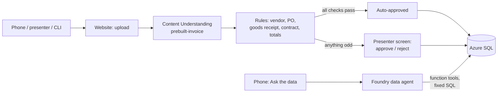

# Foundry invoice intake + data agent

A conference demo you deploy with one command. The audience scans printed invoices with their phones.
**Content Understanding** in Microsoft Foundry reads each invoice, rules check it against the purchase order,
goods receipt and contract, and the result lands in **Azure SQL**: booked automatically, or sent to a person
with the reason. Then a **Foundry agent** answers questions such as *"How many invoices needed a person, and
why?"* or *"Why did margin on the 500Wh battery pack drop?"* by querying that same database.

Everything uses a fictional company, **Alpenrad Handels GmbH**, an e-bike parts wholesaler in Vienna.



## What's in the box

| Path | What |
|---|---|
| `infra/` | Bicep: Foundry resource + project + 2 model deployments, Azure SQL (serverless), Storage, App Service, App Insights, role assignments |
| `db/` | Schema and the views the agent's tools query |
| `src/app/` | The web app: mobile page, presenter screen, API, intake pipeline, Content Understanding client, rules, agent + SQL tools |
| `scripts/` | Setup and demo tooling: seed data, Content Understanding defaults, agent creation, sample invoices, CLI intake/load test, cleanup |
| `docs/DEMO_SCRIPT.md` | Stage flow and checklist |
| `tests/` | Unit and smoke tests (no Azure needed): `python -m pytest` |

## Prerequisites

- Azure subscription where you're **Owner** (or Contributor + User Access Administrator), because the template creates role assignments.
- Tools: [Azure Developer CLI](https://aka.ms/azd) (`azd`), [Azure CLI](https://aka.ms/azcli) (`az`), Python **3.10–3.12**, VS Code.
- Model quota in your region for `gpt-5.2` and `text-embedding-3-large` (Global Standard), 100K TPM each by default.
- On macOS/Linux, the SQL driver needs a few system libraries:
  macOS `brew install openssl`; Ubuntu/Debian `sudo apt-get install libltdl7 libkrb5-3 libgssapi-krb5-2`.

## Deploy

```bash
python -m venv .venv
source .venv/bin/activate            # Windows: .venv\Scripts\Activate.ps1
pip install -r scripts/requirements.txt -r src/requirements.txt

az login
azd auth login

azd env new invoice-demo
azd env set AZURE_LOCATION swedencentral     # must support Content Understanding (EU: swedencentral, westeurope, uksouth)
azd up
```

`azd up` takes 10–15 minutes. After the Azure resources exist, [`scripts/postprovision.py`](scripts/postprovision.py):

1. stores the presenter key in the web app settings,
2. adds your IP to the SQL firewall,
3. creates tables and views, gives the web app's managed identity access, seeds ~18 months of data,
4. maps Content Understanding's prebuilt analyzers to your model deployments,
5. creates the Foundry agent `invoice-data-agent`,
6. renders the printable sample invoices and a QR code into `samples/`.

It prints the **audience URL** and the **presenter URL** (with `?key=`). Role assignments can take a few
minutes to apply; the hook retries. If a step still fails, run `python scripts/postprovision.py` again.

### Try it

1. Open `samples/01_clean_brennerwerk.pdf` on your screen, open the audience URL on your phone,
   **Scan an invoice** → photograph it. It's auto-approved in about 10–20 seconds.
2. Scan `02_price_above_contract_voltaris.pdf`: it goes to a person with "Price above contract (+12%)".
3. Open the presenter URL on your laptop and approve it.
4. On the phone, **Ask the data**: "How many invoices did the audience scan, and how many needed a person?"

| Sample | Result | Why |
|---|---|---|
| 01 Brennerwerk, 05 Nordkap | Auto-approved | Vendor, PO, goods receipt, contract price and totals all match |
| 02 Voltaris | Sent to a person | Unit price 12% above contract |
| 03 Lago | Sent to a person | No purchase order number |
| 04 Tauern | Sent to a person | Poor scan; 6 motors billed, only 4 received |

From the terminal: `python scripts/send_invoice.py samples/*.pdf` prints status, time and confidence per invoice.

## How it works

**Intake** ([`src/app/pipeline.py`](src/app/pipeline.py)), one function you can walk through on stage:

1. Store the upload in Blob Storage.
2. **Content Understanding** `prebuilt-invoice` extracts fields with confidence scores ([`content_understanding.py`](src/app/content_understanding.py)).
3. **Rules** ([`rules.py`](src/app/rules.py)) match vendor, purchase order, goods receipt and contract, and check totals, confidence, duplicates and the auto-approval limit.
4. **Decide**: every failed rule sends the invoice to a person with the reason; only a clean invoice is booked automatically.
5. Write header, lines and an audit entry to Azure SQL.

**Data agent** ([`agents.py`](src/app/agents.py), [`data_tools.py`](src/app/data_tools.py)): a Foundry prompt agent
with five function tools (invoice stats, recent invoices, supplier price deviations, sales summary, margin trend).
The agent picks a tool and arguments; the app runs a fixed, parameterized SQL query and gives the rows back.
The model never writes SQL, so it can only read what the tools expose.

## Run locally (VS Code)

```bash
azd env get-values > .env
```
Then **Run and Debug → Web app (FastAPI)** (or `cd src && python -m uvicorn app.main:app --reload`) and open
<http://localhost:8000> and `http://localhost:8000/presenter?key=<PRESENTER_KEY>`. Locally everything runs as you
(`az login`): you're SQL admin and the template gave you the Foundry and Storage roles.

## Configuration

`azd env set NAME value`, then `azd provision`.

| Setting | Default | What |
|---|---|---|
| `AZURE_LOCATION` | – | Region; must support Content Understanding |
| `CHAT_MODEL_NAME` / `CHAT_MODEL_VERSION` | `gpt-5.2` / `2025-12-11` | Model for the agent and Content Understanding |
| `MODEL_SKU_NAME` | `GlobalStandard` | `DataZoneStandard` keeps processing in the EU/US data zone |
| `APP_SERVICE_SKU` | `B2` | Use `P1v3` on the event day |
| `AUTO_APPROVE_MAX_AMOUNT` | `5000` | Invoices above this always go to a person |
| `MIN_FIELD_CONFIDENCE` | `0.50` | Minimum confidence of invoice number, vendor, total, PO. Calibrate with `send_invoice.py` |
| `SQL_AUTO_PAUSE_DELAY` | `60` | Serverless auto-pause in minutes (`-1` = never); the first request after a pause takes ~1 minute |

App settings (App Service → Environment variables): `MAX_UPLOAD_MB` (8), `MAX_CONCURRENT_EXTRACTIONS` (8),
`UPLOADS_PER_SESSION_PER_10MIN` (8), `QUESTIONS_PER_SESSION_PER_10MIN` (15), `WEB_WORKERS` (2).

## Demo day

See [docs/DEMO_SCRIPT.md](docs/DEMO_SCRIPT.md). The short version:

```bash
python scripts/setup_database.py --reseed       # day before: fresh dates
python scripts/generate_sample_invoices.py      # print samples/all_invoices_handout.pdf
python scripts/send_invoice.py samples/01_clean_brennerwerk.jpg --source audience --repeat 60 --concurrency 20   # load test
python scripts/cleanup.py --live --yes          # right before the session
python scripts/cleanup.py --audience            # after the session
```

## Costs and cleanup

Main costs: the App Service plan and the SQL database (serverless, pauses when idle). Model and Content
Understanding usage is pay-per-use and small for a demo. Remove everything with `azd down --purge`.

## Troubleshooting

| Symptom | Fix |
|---|---|
| Model deployment fails with quota/`InvalidResourceProperties` | Model/version not available in the region or quota too low: `azd env set CHAT_MODEL_CAPACITY 50`, or pick another model (`az cognitiveservices model list -l <region>`) |
| `postprovision`: 401/403 from Content Understanding or Foundry | Role assignments still propagating. Wait 5 minutes, run `python scripts/postprovision.py` |
| `postprovision`: can't connect to SQL | Your IP isn't allowed (VPN?). SQL server → Networking → add your IP, rerun |
| `ImportError: libltdl.so.7` locally | Install the system libraries listed under Prerequisites |
| App shows "Application Error" | App Service → Log stream. First start installs system libraries and can take a few minutes |
| Clean invoice goes to a person | Read the reason. Confidence → lower `MIN_FIELD_CONFIDENCE`; duplicate → `cleanup.py --live` |
| First question is slow | The serverless database was paused; it resumes in about a minute |

## Security notes

- No keys or passwords: managed identity in Azure, your Entra login locally. Local auth is disabled on Foundry and Storage; SQL is Entra-only.
- The agent can only run the five read-only queries in `data_tools.py`.
- The audience page is anonymous but rate-limited per phone and IP, checks file types by content, limits size, and keeps each phone's invoices private to it.
- Audience uploads are deleted after two days (Storage lifecycle rule); `cleanup.py --audience` removes them right away.
- All company names, VAT IDs and IBANs are fictional, and every sample invoice says so in its footer.
