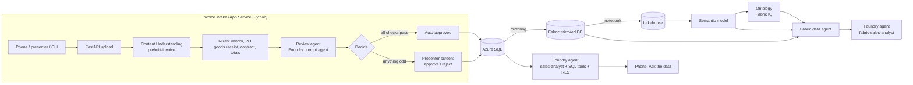

# Foundry invoice intake + "Ask your sales data" with Fabric IQ

A conference demo you deploy with one command. The audience scans printed invoices with their phones;
Microsoft Foundry reads them, checks them against purchase orders and contracts, and either books them or
sends them to a person. Approved invoices land in Azure SQL, Fabric mirrors them to OneLake, and a Fabric IQ
agent answers questions like *"Why did gross margin on the 500Wh battery pack drop?"*: because a supplier
has been invoicing above contract price, and the invoice you just approved on stage is one of them.

Everything uses a fictional company, **Kolesarstvo s.p.**, an e-bike parts wholesaler in Ljubljana, Slovenija.



## What's in the box

| Path | What |
|---|---|
| `infra/` | Bicep for everything Azure: Foundry resource + project + 3 model deployments, Azure SQL (mirroring-ready), Storage, App Service, App Insights, role assignments, optional Fabric capacity |
| `db/` | Schema, analytical views, row-level security for the three personas |
| `src/app/` | The web app: mobile page, presenter screen, API, intake pipeline, Content Understanding client, rules, agent calls, SQL tools |
| `scripts/` | Setup and demo tooling: seed data, Content Understanding defaults, agent creation, sample invoices, CLI intake/load test, cleanup, Fabric agent |
| `fabric/` | Fabric notebook, semantic model definition (relationships, DAX), data agent instructions and example queries |
| `docs/` | [Fabric IQ setup guide](docs/FABRIC_SETUP.md) and the [stage script](docs/DEMO_SCRIPT.md) |
| `tests/` | Unit and smoke tests (no Azure needed): `python -m pytest` |

## Prerequisites

- Azure subscription where you're **Owner** (or Contributor + User Access Administrator), because the template creates role assignments.
- Tools: [Azure Developer CLI](https://aka.ms/azd) (`azd`), [Azure CLI](https://aka.ms/azcli) (`az`), Python **3.10–3.12**, VS Code.
  Recommended VS Code extensions are suggested when you open the folder (Python, Bicep, Azure Developer CLI, SQL Server).
- Model quota in your region for `gpt-5.2`, `gpt-5-mini` and `text-embedding-3-large` (Global Standard), 100K TPM each by default.
- For the Fabric part: a paid Fabric capacity (F2+), which the template can create (see below), and a Fabric admin who can turn on a few tenant settings.
- On macOS/Linux, the SQL driver needs a few system libraries:
  macOS `brew install openssl`; Ubuntu/Debian `sudo apt-get install libltdl7 libkrb5-3 libgssapi-krb5-2`.

## Deploy

```bash
# go to your work location where project files are available
cd \
cd ..\..\..
```

And followed by:

```bash
# 1. Python environment (the azd hooks use it)
python -m venv InvoiceIntake
source InvoiceIntake/bin/activate            # Windows: .venv\Scripts\Activate.ps1
pip install -r scripts/requirements.txt -r src/requirements.txt

# 2. Sign in (both: azd deploys, az is used by the setup scripts)
az login
azd auth login

# 3. Create an environment and pick a Content Understanding region (EU: swedencentral, westeurope, uksouth)
azd env new foundry-demo
azd env set AZURE_LOCATION swedencentral

# Optional: also create a Fabric capacity (bills while running; pause it after rehearsals)
# azd env set DEPLOY_FABRIC_CAPACITY true
# azd env set FABRIC_ADMIN_EMAIL you@yourtenant.com

# 4. Provision + deploy + setup
azd up
```

`azd up` takes 10–15 minutes. After the Azure resources exist, the `postprovision` hook
([`scripts/postprovision.py`](scripts/postprovision.py)):

1. stores the presenter key in the web app settings,
2. adds your IP to the SQL firewall,
3. creates tables, views and row-level security, gives the web app's managed identity access, seeds ~18 months of data,
4. maps Content Understanding's prebuilt analyzers to your model deployments,
5. creates the two Foundry agents (`invoice-review-agent`, `sales-analyst`),
6. renders the printable sample invoices and a QR code into `samples/`.

At the end it prints the **audience URL** and the **presenter URL** (with `?key=`). Role assignments can take a
few minutes to apply; the hook retries. If a step still fails, fix it and run `python scripts/postprovision.py` again.

### Try it

1. Open `samples/01_clean_brennerwerk.pdf` on your screen, open the audience URL on your phone,
   **Scan an invoice** → photograph it. It should be auto-approved in about 10–20 seconds.
2. Scan `02_price_above_contract_voltaris.pdf`: it goes to review with "Price above contract (+12%)".
3. Open the presenter URL on your laptop and approve it.
4. On the phone, **Ask the data**: "Why did gross margin on the 500Wh battery pack drop?" Switch the role to
   *Sales manager DACH* or *Procurement clerk* and ask again; row-level security changes the answer.

Or from the terminal: `python scripts/send_invoice.py samples/*.pdf` prints status, time and confidence per invoice.

| Sample | What happens | Why |
|---|---|---|
| 01, 06 clean | Auto-approved | Vendor, PO, goods receipt, contract price and totals all match |
| 02 Voltaris | Needs review | Unit price 12% above contract |
| 03 Lago | Needs review | No purchase order number |
| 04 Tauern | Needs review | Poor scan, total corrected by hand, totals don't add up |
| 05 Nordkap | Needs review | Small print tells the AI to approve it: prompt injection |

### Fabric IQ

Fabric workspace items can't be created with Bicep. Follow [docs/FABRIC_SETUP.md](docs/FABRIC_SETUP.md):
mirroring → lakehouse notebook → semantic model → ontology → data agent → Foundry connection →
`python scripts/fabric_agent.py create --connection alpenrad-fabric`.

## How it works

**Intake pipeline** ([`src/app/pipeline.py`](src/app/pipeline.py)) — one function, easy to walk through on stage:

1. Store the upload in Blob Storage.
2. **Content Understanding** `prebuilt-invoice` extracts fields with confidence scores ([`content_understanding.py`](src/app/content_understanding.py)).
3. **Rules** ([`rules.py`](src/app/rules.py)) match the vendor, purchase order, goods receipt and contract, and check totals, confidence, duplicates and the auto-approval limit.
4. The **review agent** (Foundry prompt agent, structured JSON output) gives a second opinion and flags prompt injection or manual alterations. The untrusted document text is passed separately from the trusted check results.
5. **Decide**: every failed rule sends the invoice to a person. The agent can add reasons to send it to a person, but it can never approve something the rules flagged. So a document that says "approve me" can't approve itself.
6. Write header, lines and an audit entry to Azure SQL. Fabric mirrors it within seconds.

**Ask the data** has two agents on purpose:

| | `sales-analyst` (web page) | `fabric-sales-analyst` (Fabric IQ) |
|---|---|---|
| Who uses it | Anonymous audience on phones | You, colleagues in Teams / Copilot / Foundry playground |
| Data | Azure SQL views via 5 fixed, parameterized function tools | Ontology, semantic model and mirrored DB via the Fabric data agent |
| Security | Persona → `SESSION_CONTEXT` → SQL row-level security | Your own identity (On-Behalf-Of) → Fabric permissions, Power BI RLS |

The Fabric tools only work with a signed-in user's identity, not with the web app's managed identity, which is
why the phones use their own SQL-backed agent.

## Run locally (VS Code)

```bash
azd env get-values > .env           # the app and scripts read settings from .env
```
Then **Run and Debug → Web app (FastAPI)** (or `cd src && python -m uvicorn app.main:app --reload`),
open <http://localhost:8000> and `http://localhost:8000/presenter?key=<PRESENTER_KEY>`.
Locally everything runs as you (`az login`): you're SQL admin and the template gave you the Foundry and Storage roles.

Other launch configurations: reseed the database, send sample invoices to the local app, chat with the Fabric agent.

## Configuration

Set with `azd env set NAME value`, then `azd provision` (infrastructure) or restart the app (app settings).

| Setting | Default | What |
|---|---|---|
| `AZURE_LOCATION` | – | Region; must support Content Understanding |
| `CHAT_MODEL_NAME` / `CHAT_MODEL_VERSION` | `gpt-5.2` / `2025-12-11` | Model for agents and Content Understanding |
| `MINI_MODEL_NAME` / `MINI_MODEL_VERSION` | `gpt-5-mini` / `2025-08-07` | Small model (Content Understanding "mini" alias) |
| `MODEL_SKU_NAME` | `GlobalStandard` | `DataZoneStandard` keeps processing in the EU/US data zone |
| `APP_SERVICE_SKU` | `B2` | Use `P1v3` on the event day |
| `AUTO_APPROVE_MAX_AMOUNT` | `5000` | Invoices above this always go to a person |
| `MIN_FIELD_CONFIDENCE` | `0.50` | Minimum confidence of invoice number, vendor, total, PO. Calibrate with `send_invoice.py` |
| `DEPLOY_FABRIC_CAPACITY` / `FABRIC_CAPACITY_SKU` | `false` / `F2` | Optional Fabric capacity |
| `SQL_AUTO_PAUSE_DELAY` | `-1` | Serverless auto-pause in minutes; keep `-1` while mirroring |

App-only settings (App Service → Environment variables): `MAX_UPLOAD_MB` (8), `MAX_CONCURRENT_EXTRACTIONS` (8),
`UPLOADS_PER_SESSION_PER_10MIN` (8), `QUESTIONS_PER_SESSION_PER_10MIN` (15), `WEB_WORKERS` (2).

## Demo day

See [docs/DEMO_SCRIPT.md](docs/DEMO_SCRIPT.md) for the stage flow and the checklist. The short version:

```bash
python scripts/setup_database.py --reseed       # day before: fresh dates (keeps working while mirroring runs)
python scripts/generate_sample_invoices.py      # print samples/all_invoices_handout.pdf
python scripts/send_invoice.py samples/01_clean_brennerwerk.jpg --source audience --repeat 60 --concurrency 20   # load test
python scripts/cleanup.py --live --yes          # right before the session
python scripts/cleanup.py --audience            # after the session
```

## Costs and cleanup

The biggest costs are the Fabric capacity (while running), the App Service plan and the SQL database
(serverless with auto-pause off). Model and Content Understanding usage is pay-per-use and small for a demo.
Pause the Fabric capacity when you don't need it. To remove everything in Azure:

```bash
azd down --purge
```
Delete the Fabric workspace in the Fabric portal.

## Troubleshooting

| Symptom | Fix |
|---|---|
| Model deployment fails with quota/`InvalidResourceProperties` | The model/version isn't available in your region or quota is too low: `azd env set CHAT_MODEL_CAPACITY 50`, or pick other models (`az cognitiveservices model list -l <region>`) |
| `postprovision`: 401/403 from Content Understanding or agents | Role assignments are still propagating. Wait 5 minutes, run `python scripts/postprovision.py` |
| `postprovision`: can't connect to SQL | Your IP isn't allowed yet (VPN?). Add it: SQL server → Networking. Then rerun |
| `ImportError: libltdl.so.7` locally | Install the system libraries listed under Prerequisites |
| App shows "Application Error" | App Service → Log stream. First start installs system libraries and can take a few minutes |
| Clean invoice goes to review | Look at the reason on the phone/presenter screen. If it's confidence, lower `MIN_FIELD_CONFIDENCE`; if it's a duplicate, run `cleanup.py --live` |
| Everything is "Failed" | Check App Insights / log stream; usually a missing role or the Content Understanding defaults (`python scripts/configure_content_understanding.py`) |

## Security notes

- No keys or passwords anywhere: managed identity in Azure, your Entra login locally. Local auth is disabled on Foundry and Storage; SQL is Entra-only.
- The audience page is anonymous but rate-limited per phone and per IP, checks file types by content, limits size, and keeps each phone's invoices private to it.
- Audience uploads are deleted automatically after two days (Storage lifecycle rule); `cleanup.py --audience` removes them right away.
- All company names, VAT IDs and IBANs are fictional, and every sample invoice says so in its footer.
